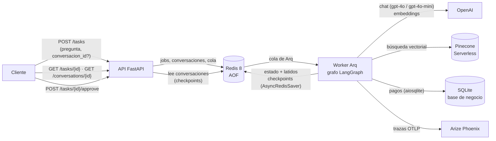
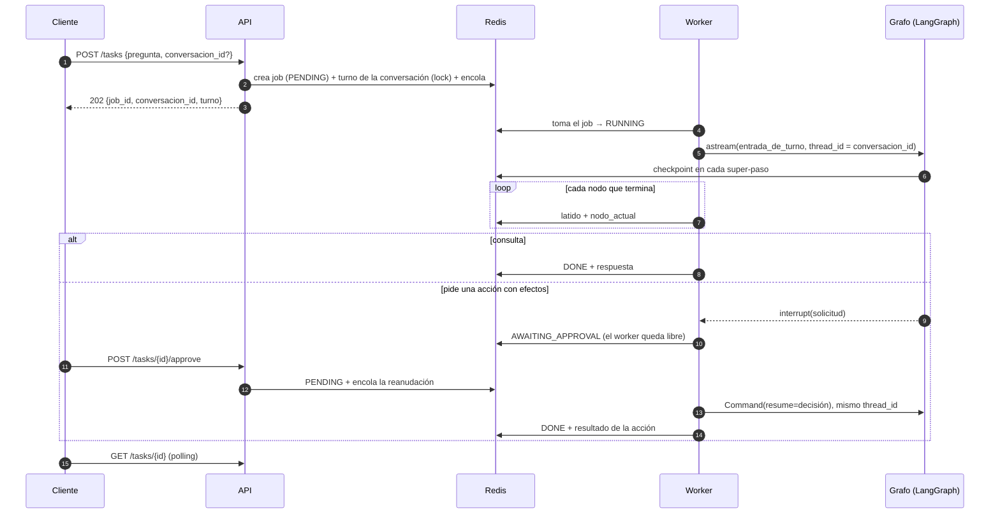
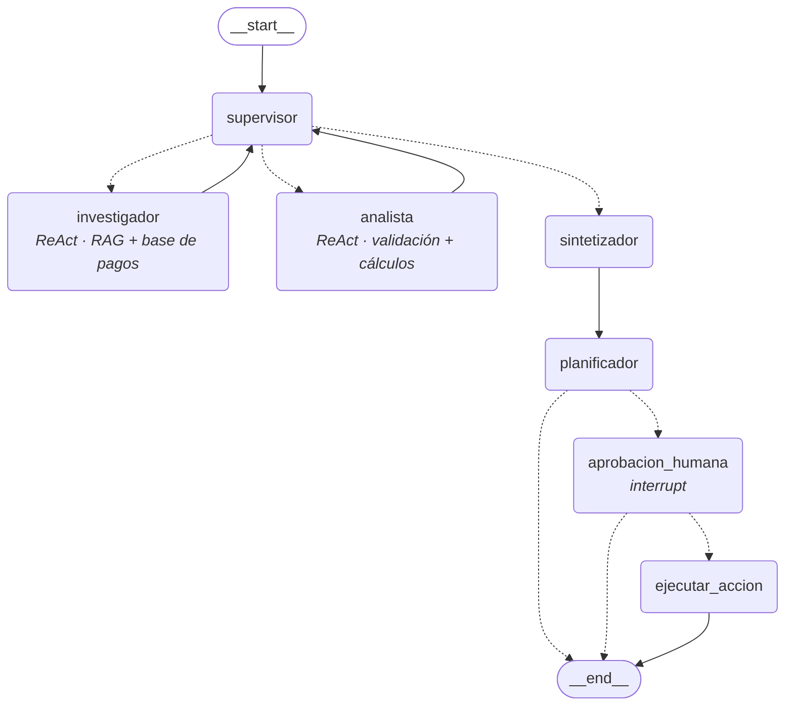

# The Intelligence System: soporte técnico de Nimbus Pagos

**Entrega final, AI Engineering**

Un sistema de IA completo para resolver consultas de soporte técnico de **Nimbus Pagos**, la plataforma de pagos
que fue el dominio de todo el curso. Una consulta típica necesita las cuatro cosas que pide la consigna:

> *El comercio Bazar Pampa viene teniendo pagos fallidos. ¿Cuál es el código de error que más se repite, qué
> significa según la documentación y cómo se resuelve? Y cuantificalo: qué porcentaje de sus pagos y qué porcentaje
> del monto total representan los fallidos por ese código.*

| Lo que pide la consigna | Cómo lo resuelve el sistema |
|---|---|
| **Conocimiento específico (RAG)** | Búsqueda **híbrida** sobre la documentación de `nimbus-sdk`: Pinecone (vectorial) + BM25 (léxico), fusionados con RRF, con metadatos por fragmento. |
| **Razonamiento multi-paso (agentes)** | Grafo de LangGraph con un **supervisor** que delega en un investigador (RAG + base de pagos) y un analista (validación y cálculos), y valida cada aporte con una rúbrica. |
| **API profesional y documentada** | FastAPI asíncrona: encola, devuelve un `job_id` en milisegundos y documenta todo en `/docs`. Conversaciones de varios turnos y aprobación humana para las acciones con efectos. |
| **Trazabilidad completa** | Cada turno es una traza en **Arize Phoenix**: nodos, subagentes, llamadas al LLM con tokens y costo, herramientas y los documentos que recuperó el RAG. Cada conversación es una sesión. |

Se levanta con **una sola instrucción**:

```bash
./run.sh            # Linux / macOS / Git Bash      (Windows PowerShell: .\run.ps1)
```

---

## Índice

1. [Mapa de la consigna](#mapa-de-la-consigna)
2. [Arquitectura](#arquitectura)
3. [El grafo de agentes](#el-grafo-de-agentes) (diagrama de flujo)
4. [RAG híbrido](#rag-híbrido)
5. [Conversaciones y persistencia](#conversaciones-y-persistencia)
6. [Validación con Pydantic](#validación-con-pydantic)
7. [Observabilidad](#observabilidad)
8. [Pruebas del sistema (con trazas)](#pruebas-del-sistema)
9. [Cómo levantarlo](#cómo-levantarlo)
10. [Tests](#tests)
11. [Lo que salió mal (y qué se cambió)](#lo-que-salió-mal)
12. [Limitaciones conocidas](#limitaciones-conocidas)
13. [De dónde sale cada pieza](#de-dónde-sale-cada-pieza)

---

## Mapa de la consigna

| Entregable | Dónde | Evidencia |
|---|---|---|
| **1. Integración** de los módulos 6 y 7 en una estructura unificada | [`app/`](app/): `agents/`, `tools/`, `rag/`, `graph.py`, `main.py`, `worker.py` | Un solo paquete, una sola imagen de Docker para la API y el worker. |
| **2. Todo asíncrono** (LLM y bases de datos) | LLM: `ainvoke` · Pinecone: `AsyncPinecone` / `AsyncIndex` · embeddings: `aembed_*` · Redis: `redis.asyncio` · SQLite: `aiosqlite` · checkpoints: `AsyncRedisSaver` · scripts: `httpx.AsyncClient` | [§ Auditoría de asincronía](#auditoría-de-asincronía): sin `requests`, sin clientes sync, I/O de disco fuera del event loop. |
| **3. Checkpointer**: las conversaciones no se pierden al reiniciar | [`app/graph.py`](app/graph.py) → `abrir_checkpointer` (`AsyncRedisSaver`, Redis con AOF), `thread_id = conversacion_id` | La batería **reinicia Redis, la API y el worker** entre el turno 1 y el 2: [resultados/pruebas-sistema-…json](resultados/pruebas-sistema-20261012-174156.json), [captura 06](screenshots/06-conversacion-dos-turnos.png). |
| **4. Pydantic** en las entradas y salidas de la API y de las herramientas | API: [`app/schemas.py`](app/schemas.py) · herramientas: `args_schema` + [`app/tools/esquemas.py`](app/tools/esquemas.py) · RAG: [`app/rag/esquemas.py`](app/rag/esquemas.py) | `test_cada_herramienta_devuelve_su_contrato`, 422 ante entradas inválidas ([§ Validación](#validación-con-pydantic)). |
| **5. ≥ 5 pruebas** con trazas en Phoenix | [`scripts/pruebas_sistema.py`](scripts/pruebas_sistema.py): 6 escenarios, 9 trazas, 31 chequeos | [§ Pruebas del sistema](#pruebas-del-sistema) y [screenshots/](screenshots/). |
| **6. README** con diagrama de flujo del grafo | Este archivo → [§ El grafo de agentes](#el-grafo-de-agentes) | El Mermaid lo genera LangGraph: `python -m app.cli diagrama` → [docs/grafo.mmd](docs/grafo.mmd). |
| **7. Despliegue local** con una sola instrucción | [`run.sh`](run.sh) / [`run.ps1`](run.ps1) → [`docker-compose.yml`](docker-compose.yml) | Probado desde cero (`docker compose down -v` y después `./run.sh`): listo en 76 s, con la indexación del RAG incluida. |
| Errores comunes: hard-coding | Índice, namespace, modelos, límites y TTL salen de `.env` ([`.env.example`](.env.example)), con defaults en [`app/config.py`](app/config.py) | Ningún nombre de modelo ni de índice fuera de `config.py` ([§ Auditoría](#auditoría-de-asincronía)). |
| Errores comunes: caja negra | 3 capas de trazas ([§ Observabilidad](#observabilidad)) | 619 spans en las 9 trazas de la batería, 0 spans perdidos. |

---

## Arquitectura



| Pieza | Por qué así |
|---|---|
| **API sin trabajo pesado** | Los endpoints solo hacen I/O asíncrono contra Redis y encolan en Arq. Un `POST` responde en milisegundos aunque el grafo tarde 25 s; ningún endpoint espera a un LLM. |
| **Worker en proceso aparte** | Corre el grafo. Escala solo (`docker compose up --scale worker=3`) y reiniciar la API no corta ninguna ejecución. Al arrancar abre el RAG: verifica el índice de Pinecone y lo reindexa solo si cambió el corpus. |
| **Redis como única fuente de estado** | Jobs, conversaciones, cola y **checkpoints de LangGraph**. Con AOF, todo sobrevive a un reinicio del contenedor. Redis 8 trae los módulos de búsqueda y JSON que necesita `AsyncRedisSaver`. |
| **Pinecone + BM25** | La mitad vectorial vive en Pinecone. La léxica corre en memoria sobre **los mismos fragmentos**, y un manifiesto en Redis garantiza que las dos mitades indexen el mismo corpus. |

### Flujo de una consulta



---

## El grafo de agentes

Diagrama de flujo generado por LangGraph desde el grafo compilado (`python -m app.cli diagrama` →
[docs/grafo.mmd](docs/grafo.mmd)). Las flechas punteadas son aristas condicionales.



| Nodo | Qué hace | Herramientas |
|---|---|---|
| `supervisor` | Decide quién trabaja y cuándo el trabajo está completo. Salida estructurada (`DecisionSupervisor`) con una **rúbrica híbrida**: `cobertura` y `coherencia` las juzga el modelo; `respaldo` lo calcula el código a partir de los chequeos. **Guardas deterministas** pisan la propuesta del modelo cuando corresponde (suficiencia, dependencia de datos, rondas por agente, instrucción repetida, límite de pasos). | — |
| `investigador` | Subgrafo ReAct (`create_react_agent`). Encuentra y cita; **no calcula**. | `buscar_documentacion` (**RAG**), `buscar_comercio`, `consultar_pagos` |
| `analista` | Subgrafo ReAct. Recibe **solo los datos crudos** que consiguió el investigador, sin su texto, y calcula todo con herramientas. | `perfilar_pagos`, `calcular`, `porcentaje` |
| `sintetizador` | Integra la última ronda de cada especialista en la respuesta: las explicaciones con su cita, las cifras solo del analista y las limitaciones reales. | — |
| `planificador` | Detecta si la solicitud además pide **ejecutar** algo (programar reintentos de pagos). El modelo propone y el código fija qué pagos y por cuánto. | — |
| `aprobacion_humana` | `interrupt(...)` con todo lo que la persona necesita para decidir. El grafo queda pausado en Redis. | — |
| `ejecutar_accion` | La única escritura del sistema. Idempotente por turno. | — |

**Autonomía con límites.** No hay un `if` sobre el texto del usuario: el supervisor decide la ruta. Lo que el modelo
*no* decide es lo verificable. Cada aporte pasa por chequeos deterministas antes de llegar al supervisor:

- citas que no salieron del RAG;
- cifras sin procedencia;
- montos en centavos presentados como moneda;
- pagos omitidos;
- herramientas que terminaron en error.

El límite de pasos garantiza que el grafo termina. **Aislamiento de contexto:** ningún especialista recibe
`state["messages"]`; cada uno recibe un mensaje armado con lo que su rol necesita ([`app/agents/base.py`](app/agents/base.py)).

---

## RAG híbrido

[`app/rag/`](app/rag/): la base de conocimiento es la documentación de `nimbus-sdk` (cinco Markdown: guía de inicio,
referencia de API, catálogo de errores, webhooks y changelog).

### Ingesta: chunking y metadatos

1. **Por sección de Markdown** (`##` / `###`), ignorando los `#` que caen dentro de bloques de código. Cada sección
   habla de una sola cosa (un código de error, un método, un evento), así que es la unidad natural para recuperar y
   citar.
2. **Por tokens** (`RecursiveCharacterTextSplitter.from_tiktoken_encoder`, 800 tokens con 100 de solape), solo si una
   sección es más larga. Cada parte conserva el título de su sección.

Resultado: **41 fragmentos de entre 22 y 484 tokens** (promedio 180), en [resultados/fragmentos.txt](resultados/fragmentos.txt).
Cada vector lleva en su metadata (`MetadatosChunk`) el texto completo, la fuente, el documento, la sección, la
categoría, la posición (`chunk_id/total_chunks`, `parte/total_partes`) y los tokens. Al embeber, el título va adelante
del texto ("Manejo de errores › Catálogo de códigos"). Es la forma más barata de *contextual retrieval*.

### Recuperación

| Paso | Detalle |
|---|---|
| Léxico | BM25 en memoria sobre los mismos fragmentos, con un tokenizador para castellano técnico (sin tildes, sin stopwords, conserva `E4090` y `capturar_pago`). |
| Vectorial | `text-embedding-3-small` (1536 dimensiones) → Pinecone Serverless, namespace propio. |
| Fusión | **RRF ponderado** (0,3 léxico / 0,7 vectorial, los pesos medidos en la Pre-entrega 4). Fusiona *posiciones*, así que no importa que los puntajes de BM25 y del coseno no sean comparables. Cada fragmento informa su posición en cada mitad (`rango_lexico`, `rango_vectorial`). |
| Degradación | Si Pinecone o la API de embeddings fallan en una consulta, responde con BM25 solo, con `modo="lexico"` y un `aviso` que ve el agente y queda en la traza. El job no termina en FAILED por eso. |

### Sincronización del índice (idempotente)

Al arrancar, el worker:

1. Crea el índice si no existe. Si existe, verifica la dimensión: un índice no se redimensiona.
2. Compara el **manifiesto** guardado en Redis con el de los fragmentos locales:
   - campos comparados: fingerprint del modelo, índice, namespace y hash del corpus;
   - si coincide y el conteo de vectores cierra, no gasta ni un embedding;
   - si no, vacía el namespace y reindexa con ids deterministas (`<archivo>::<n>`).

Con varios workers, solo uno indexa (lock en Redis). Un vector que no está en el corpus local nunca entra al ranking.

### Evaluación: el híbrido gana

`python -m app.cli evaluar-rag --k 3` sobre el golden set: las 10 preguntas de la Pre-entrega 4 más 2 nuevas del
dominio del agente (reintentabilidad), etiquetadas por tipo. Salida completa en
[resultados/evaluacion-rag.txt](resultados/evaluacion-rag.txt).

| Variante | Recall@3 | MRR | MRR léxicas | MRR semánticas |
|---|---:|---:|---:|---:|
| Léxico (BM25) | 91,7 % | 0,819 | 0,708 | 0,800 |
| Vectorial (Pinecone) | 91,7 % | 0,903 | **1,000** | 0,767 |
| **Híbrido 0,3/0,7** | 91,7 % | **0,958** | **1,000** | **0,900** |

Con k=5 el híbrido llega a **Recall 100 %**; el vectorial solo, a 95,8 %. Cada mitad falla donde la otra acierta:

- *"Al cliente no le alcanzaba el saldo de la tarjeta, ¿conviene volver a cobrarle?"*: BM25 no recupera el catálogo
  de errores en el top-3, porque la fuente dice "fondos insuficientes".
- *"¿Qué hace el método `capturar_pago`?"*: BM25 lo trae tercero.

El híbrido resuelve las dos en la posición 1.

---

## Conversaciones y persistencia

`POST /tasks` acepta un `conversacion_id` opcional. Sin él, se abre una conversación nueva; con él, se agrega un
turno. El checkpointer de LangGraph (`AsyncRedisSaver`) guarda el hilo bajo **`thread_id = conversacion_id`**.

| Qué | Cómo |
|---|---|
| **Lo que persiste entre turnos** | `messages` (reducer `add_messages`): preguntas, informes y respuestas. De ahí sale el historial que ven el supervisor, el investigador y el planificador para resolver "ese error" o "esos pagos". El analista y el sintetizador ven solo las **preguntas** anteriores: una cifra de una respuesta vieja no es un dato. |
| **Lo que es de un turno** | Contribuciones, decisiones, contador de pasos, acción propuesta. Se reinician con **`Overwrite`** ([`entrada_de_turno`](app/graph.py)): con el reducer `operator.add`, un `[]` se sumaría a lo anterior y el supervisor del turno 2 arrancaría con la rúbrica en verde y el presupuesto gastado. |
| **Un turno a la vez** | Dos turnos sobre el mismo hilo se pisarían los checkpoints. `crear` registra el turno activo en la misma transacción (`WATCH`/`MULTI`) y rechaza otro con **409** mientras no termine. Un turno pausado en `AWAITING_APPROVAL` también ocupa la conversación. |
| **Sobrevive a reinicios** | Redis con AOF + volumen. La batería de pruebas hace `docker compose restart redis api worker` entre los turnos: el turno 2 entiende "ese error" (= E4021, del turno 1) y las aprobaciones pendientes se reanudan en un worker que no es el que pausó. |
| **Leer una conversación** | `GET /conversations/{id}` lee los mensajes **del checkpoint** (no de una copia aparte) y los jobs de cada turno. Con `?incluir_trabajo=true` muestra también los pasos del supervisor y los informes. |

---

## Validación con Pydantic

| Frontera | Modelos | Qué se rechaza |
|---|---|---|
| **Entrada de la API** | `CrearTarea`, `DecisionAprobacion` | Pregunta de menos de 5 o más de 2000 caracteres, `conversacion_id` que no es un id del sistema, revisor vacío → **422**, antes de tocar Redis. |
| **Salida de la API** | `TareaEncolada`, `Job` (con `SolicitudAprobacion`, `AprobacionRegistrada`, `ResultadoAccion`), `Conversacion`, `Salud`, `ErrorAPI` | Todo lo que sale pasa por `response_model`, así que `/docs` es el contrato real. |
| **Argumentos de las herramientas** | `args_schema` de cada `@tool` | `k` fuera de 1–5, `comercio_id ≤ 0`, consultas vacías. |
| **Salida de las herramientas** | [`app/tools/esquemas.py`](app/tools/esquemas.py): `ResultadoBusqueda`, `ResultadoConsultarPagos`, `ResultadoPerfilarPagos`, … | Un `error` sin `sugerencia` (la convención del ciclo de corrección pasa a ser un tipo); una `cantidad` distinta del largo de `pagos`. |
| **Datos que analiza el analista** | `Pago` | Fallido sin código, aprobado con código, montos no enteros: se informan y se excluyen del cálculo. |
| **RAG** | `MetadatosChunk`, `Chunk`, `Manifiesto` | Metadata fuera de rango antes de embeber; metadata inválida que vuelve de Pinecone (se descarta). |
| **Salidas estructuradas del LLM** | `DecisionSupervisor`, `PropuestaAccion` | Una salida que no parsea cae en una decisión de respaldo: nunca en una acción. |

---

## Observabilidad

[`app/observability.py`](app/observability.py) registra el exportador de Phoenix (`phoenix.otel.register`, OTLP/HTTP,
`BatchSpanProcessor`) y suma tres capas:

1. **`LangChainInstrumentor` (OpenInference).** Cada nodo, subgrafo ReAct, herramienta y llamada al LLM es un span,
   con tokens y modelo. Con eso Phoenix calcula el **costo** por llamada, por traza y por sesión.
2. **Spans propios (`@trazar`).**
   - La raíz de cada turno: `tarea_nimbus`, tipo AGENT, con la pregunta y la respuesta.
   - La escritura en la base: `programar_reintentos`, tipo TOOL, con quién la aprobó.
3. **Spans del RAG** ([`app/rag/hibrido.py`](app/rag/hibrido.py)): `recuperar_documentacion` (RETRIEVER, con los
   documentos, su puntaje y metadatos), y adentro `busqueda_lexica`, `busqueda_vectorial` y `embedding_consulta`
   (EMBEDDING).

**Anidamiento correcto.** El instrumentador de LangChain no deja sus spans como "actuales" de OpenTelemetry. Sin
ajustes, los spans propios colgaban de la raíz y no de la herramienta que los originó. `contexto_padre()` resuelve el
span de LangChain en curso (`get_current_span`), así que el RETRIEVER cuelga de `buscar_documentacion` y la escritura
de `ejecutar_accion`. Hay un test que lo verifica con un exportador en memoria
([tests/test_observabilidad.py](tests/test_observabilidad.py)).

**Sesiones = conversaciones.** Todas las trazas de una conversación llevan `session.id = conversacion_id`, y en
`metadata` llevan `job_id`, `turno` y `fase` (`ejecucion` / `reanudacion`), filtrables desde el buscador de Phoenix.

### Capturas

Del Phoenix real, con las trazas de la batería de pruebas
([`scripts/capturas.py`](scripts/capturas.py) las regenera con Playwright):

| Captura | Qué muestra |
|---|---|
| [01-trazas-latencia-tokens-costo](screenshots/01-trazas-latencia-tokens-costo.png) | Las 9 trazas de la batería, con latencia, tokens y costo de cada una. |
| [02-traza-multipaso-arbol-de-spans](screenshots/02-traza-multipaso-arbol-de-spans.png) | La traza del caso multipaso: `tarea_nimbus → LangGraph → supervisor / investigador / analista / … → ChatOpenAI / herramientas`. |
| [03-rag-span-retriever-documentos](screenshots/03-rag-span-retriever-documentos.png) | El span RETRIEVER: consulta `E4090`, documentos recuperados con su puntaje, y en el árbol `buscar_documentacion → recuperar_documentacion → busqueda_lexica / busqueda_vectorial / embedding_consulta`. |
| [04-rag-span-retriever-atributos](screenshots/04-rag-span-retriever-atributos.png) | Los atributos del mismo span: modo, pesos de la fusión, y de qué mitad vino cada documento. |
| [05-sesiones-por-conversacion](screenshots/05-sesiones-por-conversacion.png) | Una sesión por conversación (6), con 1,5 trazas por sesión en promedio. |
| [06-conversacion-dos-turnos](screenshots/06-conversacion-dos-turnos.png) | La conversación de dos turnos como sesión de Phoenix: el turno 2 ("¿Y ese error es reintentable?") se responde con E4021, del turno 1, después del reinicio. |
| [07-hitl-reanudacion-aprobada](screenshots/07-hitl-reanudacion-aprobada.png) | La traza de la reanudación: `aprobacion_humana → ejecutar_accion → programar_reintentos`, con los pagos, quién aprobó y la metadata del turno. |
| [08-metricas-latencia-p95](screenshots/08-metricas-latencia-p95.png) | Pestaña *Metrics*: 9 trazas OK, 0 con error; latencia p50 14,2 s · **p95 23,1 s**; costo total US$ 0,10. |
| [09-metricas-costo-por-modelo](screenshots/09-metricas-costo-por-modelo.png) | Costo y tokens por modelo. El supervisor (`gpt-4o`) consume menos tokens que los especialistas (`gpt-4o-mini`) pero explica **US$ 0,09 de los ~0,10** de la corrida: es la primera palanca si hiciera falta bajar el costo. |

---

## Pruebas del sistema

```bash
python scripts/pruebas_sistema.py      # contra el stack levantado con run.sh
```

Seis conversaciones, cada una una sesión en Phoenix. Corren en paralelo en dos fases y **entre las fases se reinician
Redis, la API y el worker**. Los chequeos son estructurales (estado, nodos recorridos, fuente citada, acción ejecutada
o no), no comparaciones del texto del LLM. Corrida del 12/10/2026 sobre un despliegue desde cero
([resultados/pruebas-sistema-20261012-174156.json](resultados/pruebas-sistema-20261012-174156.json)):

| # | Escenario | Qué prueba | Recorrido | Latencia · tokens · costo | Chequeos |
|---|---|---|---|---|---|
| 1 | `rag_documentacion` | Solo documentación: cómo probar sin mover plata y qué revisar antes de producción | supervisor → investigador → síntesis | 14,2 s · 9.916 · US$ 0,01 | ✔ 4/4 |
| 2 | `multipaso` | RAG + pagos + cálculos (Bazar Pampa: E4090, **42,86 %** de los pagos, **58,83 %** del monto) | supervisor → investigador → analista → síntesis | 23,4 s · 20.270 · US$ 0,02 | ✔ 5/5 |
| 3 | `conversacion` | Turno 1: código de Café Tortoni Centro (E4021). **Reinicio.** Turno 2: "¿y ese error es reintentable?" | 2 trazas en la misma sesión | 11,4 s + 9,8 s · 16.784 · US$ 0,02 | ✔ 7/7 |
| 4 | `hitl_aprobado` | "Programá el reintento" de 2 pagos E5030 de Viajes Aconcagua → pausa → **reinicio** → aprobado → se ejecuta | … → planificador → aprobacion_humana → ejecutar_accion | 21,1 s + 0,25 s | ✔ 6/6 |
| 5 | `hitl_rechazado` | Reintentar E4090 (**no reintentable**): la pausa trae la ADVERTENCIA y los 3 pagos; se rechaza; no se escribe nada | … → aprobacion_humana → fin | 22,5 s + 0,22 s | ✔ 7/7 |
| 6 | `comercio_inexistente` | La herramienta devuelve `error` + `sugerencia`; el investigador reintenta con variantes y el sistema responde que no existe, sin inventar pagos | investigador ×2 | 15 s · 13.943 · US$ 0,01 | ✔ 2/2 |

Además, la batería verifica la validación de entrada (422 en los dos casos) y que la conversación siga en el
checkpoint después del reinicio. **31/31 chequeos.** En Phoenix: 9 trazas, 619 spans, **0 errores y 0 spans
perdidos**; p95 de 23,1 s y US$ 0,10 por toda la corrida.

Para ver la concurrencia, [`scripts/prueba_carga.py`](scripts/prueba_carga.py) (de la Pre-entrega 7) manda 5
consultas a la vez y mide la latencia del `POST` (milisegundos) contra la de punta a punta.

---

## Cómo levantarlo

### Requisitos

- **Docker** (Docker Desktop en Windows/macOS).
- Claves de **OpenAI** (chat y embeddings) y **Pinecone** (plan gratuito; el índice lo crea el sistema).
- Python **3.12** (declarado en [`.python-version`](.python-version) y en la imagen `python:3.12-slim`), solo para correr los tests y los scripts de prueba desde la máquina local.

### Una sola instrucción

```bash
./run.sh
```

En Windows PowerShell:

```powershell
.\run.ps1
```

La primera vez, si no hay `.env`, lo crea desde [`.env.example`](.env.example) y avisa qué claves completar
(`OPENAI_API_KEY`, `PINECONE_API_KEY`). Después:

1. Verifica Docker y las claves.
2. Corre `docker compose up -d --build` (Redis, Phoenix, la API y el worker).
3. Espera a que Phoenix responda y a que el worker haya abierto el RAG. La primera vez indexa la documentación en
   Pinecone, en unos 5 s.

`./run.sh --logs` sigue los logs y `./run.sh --down` apaga el stack (los datos quedan en los volúmenes).

| Servicio | URL | Qué es |
|---|---|---|
| `api` | http://localhost:8000/docs | Swagger con todos los endpoints y modelos |
| `phoenix` | http://localhost:6006 | Trazas (proyecto `nimbus-intelligence`) |
| `redis` | `localhost:6379` | Jobs, conversaciones, cola y checkpoints |
| `worker` | — | Corre el grafo. `docker compose up -d --scale worker=3` para escalar |

Sin cuenta de Pinecone: `RAG_MODO=lexico` en `.env` levanta todo con BM25 solo, con menor calidad de recuperación.

### Usarlo

```bash
curl -s -X POST localhost:8000/tasks -H "content-type: application/json" \
  -d '{"pregunta": "¿Qué código de error tuvo el pago fallido de Café Tortoni Centro y qué significa?"}'
# → {"job_id": "…", "conversacion_id": "…", "turno": 1, "estado": "PENDING", ...}

curl -s localhost:8000/tasks/<job_id>                       # repetir hasta DONE

curl -s -X POST localhost:8000/tasks -H "content-type: application/json" \
  -d '{"pregunta": "¿Y ese error es reintentable?", "conversacion_id": "<conversacion_id>"}'

curl -s localhost:8000/conversations/<conversacion_id>
```

En PowerShell (con UTF-8 para que los acentos lleguen bien):

```powershell
$cuerpo = @{ pregunta = "Viajes Aconcagua tuvo pagos fallidos por E5030. Explicame qué significa y programá el reintento." } | ConvertTo-Json
$job = Invoke-RestMethod -Method Post -Uri http://localhost:8000/tasks -ContentType "application/json; charset=utf-8" -Body ([Text.Encoding]::UTF8.GetBytes($cuerpo))
Invoke-RestMethod http://localhost:8000/tasks/$($job.job_id)          # hasta AWAITING_APPROVAL
$ok = @{ aprobado = $true; revisor = "yo"; comentario = "E5030 es reintentable" } | ConvertTo-Json
Invoke-RestMethod -Method Post -Uri http://localhost:8000/tasks/$($job.job_id)/approve -ContentType "application/json" -Body $ok
```

### Endpoints

| Método | Ruta | Respuesta |
|---|---|---|
| `POST` | `/tasks` | `{pregunta, conversacion_id?}` → **202** `{job_id, conversacion_id, turno, estado, url_estado, url_conversacion}` · **404** conversación inexistente · **409** conversación con un turno sin terminar · **422** entrada inválida |
| `GET` | `/tasks/{job_id}` | Estado del turno: `estado`, `nodo_actual`, `nodos`, `aprobacion_pendiente`, `respuesta`, `resultado_accion`, `error`, duraciones |
| `POST` | `/tasks/{job_id}/approve` | `{aprobado, revisor, comentario}` → **202** (reanudación encolada) · **409** si no está en `AWAITING_APPROVAL` |
| `GET` | `/tasks?estado=&limite=` | Últimos jobs |
| `GET` | `/conversations/{id}?incluir_trabajo=` | Mensajes leídos del checkpoint + los jobs de cada turno |
| `GET` | `/health` | `{api, redis, checkpointer, rag}` (`rag` lo informa el worker: `hibrido`, `lexico` o `sin worker`) |

Ciclo de vida de un turno: `PENDING → RUNNING → DONE | FAILED | AWAITING_APPROVAL → (approve) → PENDING → …`.
Ningún job queda colgado:

- una excepción del grafo o del LLM lo pasa a `FAILED`;
- también un timeout o el apagado del worker;
- un worker que muere sin avisar deja de latir, y el job se marca `FAILED` en la próxima lectura.

### CLI

```bash
python -m app.cli fragmentos           # el chunking del corpus (sin red)
python -m app.cli buscar "E4090"       # una búsqueda híbrida, con de qué mitad vino cada fragmento
python -m app.cli evaluar-rag --k 3    # léxico vs. vectorial vs. híbrido
python -m app.cli indexar              # sincroniza Pinecone (lo hace el worker al arrancar)
python -m app.cli diagrama             # Mermaid del grafo → docs/grafo.mmd
python -m app.cli reintentos           # lo que escribió la acción aprobada
```

### Variables de entorno principales

Todas están documentadas en [`.env.example`](.env.example).

| Variable | Default | Para qué |
|---|---|---|
| `OPENAI_API_KEY`, `PINECONE_API_KEY` | — | Obligatorias (Pinecone no, con `RAG_MODO=lexico`) |
| `PROVEEDOR` / `MODELO` / `MODELO_SUPERVISOR` | `openai` / `gpt-4o-mini` / `gpt-4o` | Chat; `PROVEEDOR=anthropic` también funciona |
| `RAG_MODO` | `hibrido` | `hibrido` o `lexico` |
| `INDEX_NAME` / `PINECONE_NAMESPACE` | `nimbus-sdk-docs` / `nimbus-sdk-final` | Índice y namespace (se crean solos) |
| `EMBEDDING_MODEL` | `text-embedding-3-small` | La dimensión se deriva del modelo |
| `PESO_BM25` / `PESO_VECTORIAL` / `RAG_TOP_K` | `0.3` / `0.7` / `3` | Fusión y cantidad de fragmentos |
| `HISTORIAL_MAX_TURNOS` / `TTL_CONVERSACION_SEGUNDOS` | `4` / 7 días | Conversaciones |
| `MAX_PASOS_SUPERVISOR` / `MAX_RONDAS_POR_AGENTE` | `6` / `2` | Condiciones de parada |
| `PHOENIX_PROJECT_NAME` | `nimbus-intelligence` | Proyecto de Phoenix |

### Auditoría de asincronía

Todo el I/O de la API y del worker es asíncrono:

| Recurso | Cliente |
|---|---|
| Chat | `ainvoke` |
| Embeddings | `aembed_query` / `aembed_documents` (`AsyncOpenAI`) |
| Pinecone | `AsyncPinecone` / `AsyncIndex` |
| Redis | `redis.asyncio`, Arq y `AsyncRedisSaver` |
| SQLite | `aiosqlite` |
| Scripts | `httpx.AsyncClient` |

Las herramientas de cálculo también son `async def`. Las lecturas de disco del arranque (el corpus, la tabla de
códigos reintentables) corren en un hilo (`asyncio.to_thread`). No hay `requests`, `time.sleep` ni clientes
síncronos dentro de una corutina, y ningún nombre de modelo o de índice aparece fuera de `app/config.py`.

---

## Tests

```bash
pip install -r requirements-dev.txt
pytest
```

**131 tests en ~17 s, sin red, sin Docker y sin API keys.**

| Pieza | Reemplazo en los tests |
|---|---|
| Redis | `fakeredis` |
| Modelos | `LLMFalso`, con guion fijo por rol |
| Checkpointer | `InMemorySaver`, mismo contrato que el `AsyncRedisSaver` |
| RAG | Léxico, o con un índice vectorial falso |
| Trazas | Exportador en memoria |

| Archivo | Tests | Qué cubre |
|---|---:|---|
| [test_rag.py](tests/test_rag.py) | 19 | Chunking por sección y por tokens, metadatos validados, hash, BM25, fusión RRF, el híbrido trae lo semántico, **degradación a BM25 si Pinecone falla**, vectores desconocidos fuera del ranking, sincronización idempotente (indexa una vez, reindexa si cambia el corpus o falta un vector), dimensión incompatible, golden set |
| [test_conversaciones.py](tests/test_conversaciones.py) | 9 | El turno 2 ve el historial del 1 y **arranca sin sus contribuciones** (`Overwrite`) · la conversación sobrevive a descartar el grafo · 409 con un turno en curso, con dos `POST` concurrentes y con una aprobación pendiente · un turno fallido libera la conversación · `GET /conversations` lee el checkpoint |
| [test_observabilidad.py](tests/test_observabilidad.py) | 2 | El RETRIEVER cuelga de `buscar_documentacion` y trae los documentos · cada turno es una traza con `session.id = conversacion_id` y su metadata |
| [test_herramientas.py](tests/test_herramientas.py) | 27 | Las 6 herramientas, sus argumentos inválidos y **su contrato de salida** |
| [test_api.py](tests/test_api.py) | 14 | Encolar sin correr el grafo, 5 `POST` concurrentes, `FAILED` ante excepción, cancelación y worker sin latido, 503 si no se puede encolar, flujo HITL por la API, doble aprobación → 202 + 409 |
| [test_hitl.py](tests/test_hitl.py) | 15 | La acción crítica pausa **antes** de escribir, rechazo y respuesta ambigua no escriben, solo pagos consultados y fallidos, advertencia de código no reintentable, idempotencia |
| [test_grafo.py](tests/test_grafo.py), [test_supervisor.py](tests/test_supervisor.py), [test_chequeos.py](tests/test_chequeos.py) | 45 | Delegación, aislamiento de contexto, guardas contra el supervisor infinito, chequeos de procedencia de cifras y de pagos omitidos, limitaciones inventadas |

---

## Estructura

```
├── app/
│   ├── main.py              # FastAPI: tasks, approve, conversations, health
│   ├── worker.py            # Arq: abre el RAG, corre / reanuda el grafo, estados (FAILED incluido)
│   ├── jobs.py              # jobs y conversaciones en Redis (transiciones atómicas, lock por conversación)
│   ├── graph.py             # el grafo + AsyncRedisSaver + entrada_de_turno (Overwrite)
│   ├── state.py             # estado compartido + historial de la conversación
│   ├── hitl.py              # criticidad, interrupt, aprobación y ejecución de la acción
│   ├── observability.py     # Phoenix + OpenInference + @trazar + contexto_padre
│   ├── schemas.py           # modelos de la API
│   ├── config.py · cola.py · cli.py
│   ├── agents/              # supervisor, investigador, analista, sintetizador, planificador
│   ├── tools/               # herramientas + esquemas.py (contratos de salida)
│   ├── rag/                 # corpus, lexico, vectorial (Pinecone async), hibrido, evaluacion, docs/, golden_set.json
│   └── fuentes/db.py        # base de comercios y pagos (aiosqlite)
├── scripts/
│   ├── pruebas_sistema.py   # 6 escenarios con reinicio en el medio
│   ├── capturas.py          # capturas de Phoenix (Playwright)
│   └── prueba_carga.py      # 5 peticiones concurrentes
├── tests/                   # 131 tests sin red
├── resultados/              # pruebas del sistema, evaluación del RAG, chunking
├── screenshots/             # evidencia de observabilidad
├── docs/grafo.mmd           # el diagrama, generado por LangGraph
├── run.sh · run.ps1         # despliegue con una sola instrucción
├── docker-compose.yml · Dockerfile
└── requirements.txt · requirements-dev.txt · .env.example
```

---

## Lo que salió mal

Cada una de estas cosas pasó en una corrida real de esta entrega, y el sistema cambió por eso.

**1. Phoenix perdía las primeras trazas.** En un despliegue desde cero, Phoenix tarda cerca de un minuto en arrancar
(corre las migraciones de su base) y el worker ya estaba listo. Los spans de las primeras consultas se exportaban a
un puerto cerrado y, después de los reintentos, se descartaban: de 9 trazas llegó 1. Ahora Phoenix tiene healthcheck,
el worker espera a que esté sano (`depends_on: service_healthy`) y `run.sh` no da el sistema por listo sin Phoenix.
La corrida desde cero posterior: 9 de 9 trazas, 0 spans perdidos.

**2. Los spans propios colgaban de la raíz.** El RETRIEVER del RAG y la escritura en la base aparecían al final del
árbol, desconectados de la herramienta que los originó: el instrumentador de LangChain no deja sus spans como
contexto actual. Se resolvió con `contexto_padre()` + `get_current_span` y hay un test que fija la jerarquía. En el
mismo paso apareció otra cosa: `using_attributes` solo lo leen los instrumentadores de OpenInference, así que la raíz
de cada traza no tenía `session.id`. Ahora se copia explícitamente.

**3. El sintetizador inventaba limitaciones.** Pese al prompt, `gpt-4o-mini` cerraba respuestas correctas con
"Limitaciones: el cálculo le corresponde a otro agente" o "no se puede programar el reintento en esta respuesta":
aclaraciones de rol presentadas como si faltara algo. También agregaba "el analista no intervino" en consultas que no
necesitaban cálculos. Como en el resto del sistema, lo verificable no se deja librado al modelo:

- "no intervino" solo se informa si el cierre fue forzado;
- si la entrada no traía limitaciones, la sección se recorta de la salida.

**4. El investigador "deduplicaba" pagos.** Bazar Pampa tiene 3 fallidos por E4090, y en dos corridas el investigador
listó 2: salteaba `pay_10403`, que tiene el mismo monto que `pay_10402` y es de un minuto después. La aprobación
humana nunca se vio afectada, porque la acción la arma el código con los datos crudos y propuso los 3, pero la
respuesta al usuario sí. Ahora un chequeo (`chequeo_pagos_incompletos`) marca el informe como incompleto y el
supervisor pide la corrección; la respuesta pasó a decir "3 pagos fallidos".

**5. Las conversaciones heredaban el turno anterior.** El primer intento de conversaciones (mismo hilo, misma entrada)
habría arrancado el turno 2 con las contribuciones y el contador de pasos del turno 1: el supervisor vería la rúbrica
en verde y cerraría sin trabajar. Los campos de turno se reinician con `Overwrite`, y los agentes toman la **última**
pregunta, no la primera. Hay tests para las dos cosas.

Los errores que dieron forma al orquestador (cifras inventadas que recorrían todo el sistema, el supervisor que
juzgaba respaldo sin ver los datos, montos en centavos presentados como moneda, la necesidad de `gpt-4o` en el
supervisor) están documentados en la [Pre-entrega 6](https://github.com/PedroFassanelli/AI-Pre6#lo-que-salió-mal).

---

## Limitaciones conocidas

- **La calidad del texto es la de `gpt-4o-mini`.** Las cifras, las citas y las acciones están verificadas por
  código, pero la redacción puede ser redundante o enumerar de más.
- **El golden set es chico** (12 preguntas, 5 documentos). Alcanza para ver que el híbrido le gana a cada mitad, no
  para afinar los pesos con precisión.
- **Una sola acción con efectos** (programar reintentos), con umbrales de "monto alto" en centavos que no distinguen
  moneda. No cambia qué se aprueba (toda acción con efectos pide aprobación), sí la razón que se muestra.
- **Un job huérfano se detecta al leerlo:** pasa a `FAILED` recién cuando alguien lo consulta después de
  `SIN_LATIDO_SEGUNDOS`.
- **Phoenix y la API corren sin autenticación** (configuración local de desarrollo). En un despliegue real irían con
  `PHOENIX_ENABLE_AUTH` y autenticación en la API.

---

## De dónde sale cada pieza

| Pre-entrega | Qué aporta a este sistema |
|---|---|
| [1](https://github.com/PedroFassanelli/AI-Pre1) · Cliente LLM asíncrono | El principio de todo el sistema: async de punta a punta y errores como datos, no como excepciones. |
| [2](https://github.com/PedroFassanelli/AI-Pre2) · Cadena LCEL con Pydantic | La salida estructurada validada (hoy: `DecisionSupervisor`, `PropuestaAccion`). |
| [3](https://github.com/PedroFassanelli/AI-Pre3) · RAG local | El guardián del fingerprint (hoy, el manifiesto del índice) y las citas verificables. |
| [4](https://github.com/PedroFassanelli/AI-Pre4) · RAG en Pinecone | El corpus, el recuperador híbrido, los pesos 0,3/0,7, el golden set y la evaluación. |
| [5](https://github.com/PedroFassanelli/AI-Pre5) · Agente ReAct con memoria | La base de comercios y pagos, las herramientas con `error` + `sugerencia`, el `LLMFalso` de los tests. |
| [6](https://github.com/PedroFassanelli/AI-Pre6) · Orquestador multi-agente | El supervisor, los especialistas, la rúbrica, las guardas y los chequeos. |
| [7](https://github.com/PedroFassanelli/AI-Pre7) · API de producción | FastAPI + Arq + Redis, el checkpointer, Phoenix y el Human-in-the-loop. |

Lo nuevo de esta entrega:

- el RAG híbrido async sobre Pinecone integrado al agente, con sincronización del índice y spans RETRIEVER;
- conversaciones persistentes de varios turnos;
- contratos de salida para todas las herramientas;
- la batería de pruebas con reinicio y el despliegue con una sola instrucción.
